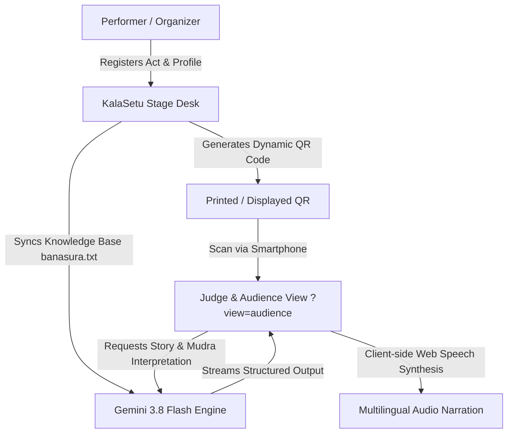

# 🪔 KalaSetu (ಕಲಾಸೇತು) — Digital Cultural Companion & Live Stage AI

[](https://python.org)
[](https://streamlit.io)
[](https://ai.google.dev/)
[](LICENSE)

> **KalaSetu (Bridge of Arts)** transforms classical and folk performing arts—such as Yakshagana, Bharatanatyam, Kathakali, and Mohiniyattam—into an accessible, immersive, and interactive experience using Google Gemini Multimodal AI and frictionless QR stage orchestration.

---

## 🌟 Key Highlights & Capabilities

### 📱 1. Dual-Route Venue Architecture
- **Stage & Performer Desk (`/`)**: Artists and stage organizers register performances (e.g. *Banasura Mohini*), configure live act timelines, manage profiles, and generate live QR codes.
- **Audience & Judge Companion (`/?view=audience`)**: Ultra-fast, mobile-optimized experience launched instantly when attendees or judges scan the stage QR code.

### ⚡ 2. Dynamic Multichannel QR Generation
- **Local Stage LAN Link**: Auto-resolves venue Wi-Fi IP (`http://<LAN-IP>:8501/?view=audience&...`) for real-time mobile companion sync.
- **Offline vCard 3.0 QR**: Allows judges and spectators to save the artist's full contact card directly into their phone address book with zero internet access required.
- **Direct WhatsApp Bridge**: Instant contact button for bookings and cultural invitations.

### 👁️ 3. Multimodal Dance Form & Mudra Recognition
- Upload or capture photographs of classical dancers to identify dance form, costume symbolism, makeup style (Vesha), and mudras with sub-second analysis powered by **Gemini 3.8 Flash**.

### 📖 4. Grounded Cultural Storytelling (RAG)
- Powered by authentic master texts (`banasura.txt` covering mythological narratives like *Banasura - Usha - Aniruddha - Krishna Sangrama*).
- AI generates structured synopses, moral themes, character dramatis personae, and real-time act-by-act guidance.

### 🎙️ 5. Multilingual In-Browser Audio Narration
- Uses the HTML5 Web Speech Synthesis API to read act synopses aloud in **English, Kannada, Hindi, and Tamil** without latency or external audio hosting fees.

### ✋ 6. Classical Mudra Knowledge Hub
- High-resolution library featuring 8 classical Asamyuta and Samyuta Hastas (*Pataka, Trishula, Alapadma, Mushti, Shikara, Shivalinga, Hamsasya, Anjali*) complete with authentic Sanskrit shlokas from the *Abhinaya Darpana* and cultural meanings.

---

## 🏗️ Architecture Overview



---

## 🚀 Getting Started

### Prerequisites
- Python 3.10, 3.11, or 3.12
- A Google Gemini API key ([Get one free at Google AI Studio](https://aistudio.google.com/app/apikey))

### 1. Clone the Repository
```bash
git clone https://github.com/<your-username>/kalasetu.git
cd kalasetu
```

### 2. Create and Activate Virtual Environment
```bash
# Windows
python -m venv .venv
.venv\Scripts\activate

# Linux / macOS
python3 -m venv .venv
source .venv/bin/activate
```

### 3. Install Dependencies
```bash
pip install -r requirements.txt
```

### 4. Configure Environment Variables
Create a `.env` file from the provided `.env.example`:
```bash
cp .env.example .env
```
Edit `.env` to add your Gemini API key:
```ini
GEMINI_API_KEY=your_actual_gemini_api_key_here
```

### 5. Launch the Application
```bash
streamlit run app.py
```
Once started, the application will display:
- **Local URL:** `http://localhost:8501`
- **Network URL:** `http://<your-lan-ip>:8501` *(Phones connected to the same Wi-Fi can scan the generated QR to access the live audience view)*

---

## 📂 Repository Structure

```
kalasetu/
├── app.py                   # Main Streamlit application (Dual-route UI & Gemini integration)
├── banasura.txt             # Mythological master text & cultural knowledge base
├── requirements.txt         # Core dependencies
├── .env.example             # Template for API credentials
├── .gitignore               # Ignored local files, keys, and environments
├── README.md                # Project documentation
│
└── Mudra Reference Assets:
    ├── alapadma mudra.jpg
    ├── anjali mudra.jpg
    ├── hamasya mudra.jpg
    ├── mushti mudra.jpg
    ├── pataka mudra.jpg
    ├── shikara mudra.jpg
    ├── shivalinga mudra.jpg
    └── trishula mudra.jpg
```

---

## 🎨 Cultural Significance

Classical Indian performing traditions like **Yakshagana** (the ancient theatre of Karnataka), **Bharatanatyam**, and **Kathakali** use highly stylized vocabularies of *Mudras* (gestures), *Navarasas* (emotions), and elaborate costumes (*Vesha*).

Many audience members, tourists, and younger generations struggle to follow complex mythological storylines during live performances. **KalaSetu bridges this gap** by translating ancient visual grammar into real-time, bite-sized, accessible intelligence on any smartphone.

---

## 🛡️ Security Note

This repository enforces strict protection of credentials. No API keys are committed or tracked in version control. All keys must be placed in a local `.env` file or supplied dynamically via the application interface.

---

## 📄 License
This project is licensed under the MIT License - see the LICENSE file for details.
